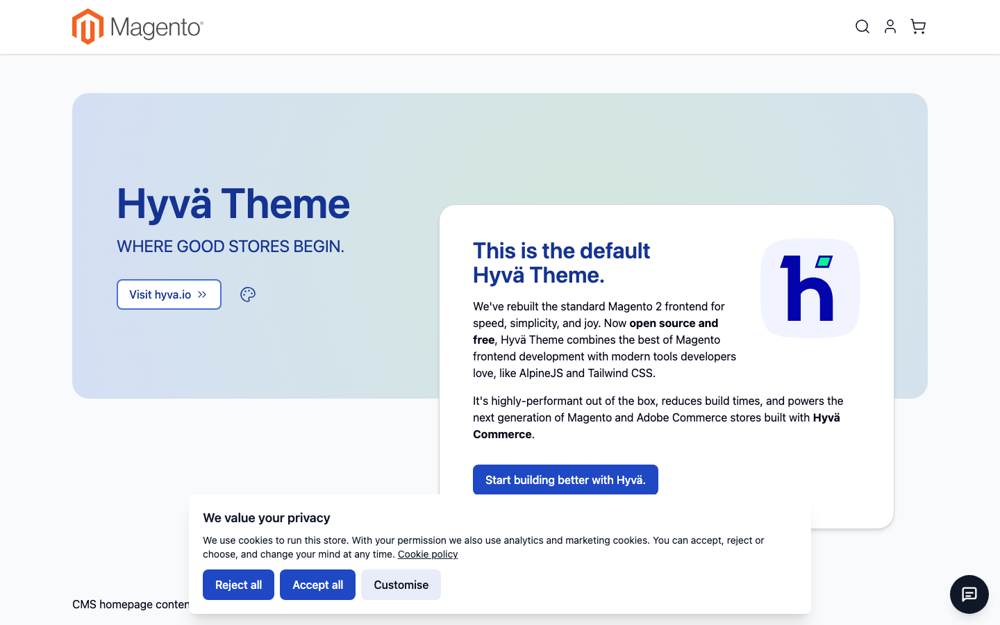
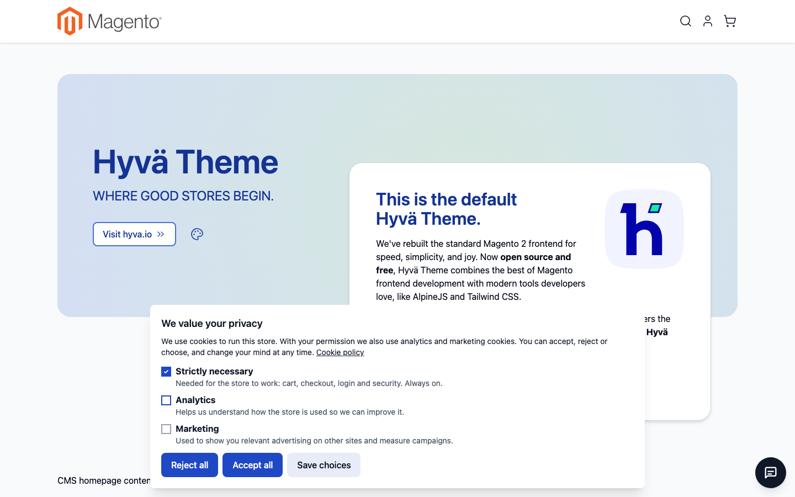

# BlueFairy Cookie Consent for Hyvä

`bluefairy/module-cookie-consent-hyva` (`BlueFairy_CookieConsentHyva`), MIT licence.

Replaces the Luma banner of `bluefairy/module-cookie-consent` with an Alpine.js banner and
preferences centre on Hyvä themes. All decisions (re-consent, GPC/DNT, regions, script release,
Consent Mode updates) are made by the core module's engine; this package is only the view.

## Install

```
composer require bluefairy/module-cookie-consent-hyva
bin/magento module:enable BlueFairy_CookieConsentHyva
bin/magento setup:upgrade
```

Then rebuild your Hyvä theme's CSS (`npm run build` in the theme's `web/tailwind` directory):
the module registers its templates with Hyvä's Tailwind config generator.

The banner uses the theme's `btn` and `btn-primary` classes, with Reject and Accept styled the same.
Customise hides itself once the preferences are open and moves keyboard focus to the first
choice.

Included with a BlueFairy Cookie Consent purchase (`bluefairy/module-cookie-consent`), which it
requires. Magento Open Source 2.4.8 or later, PHP 8.3 or later, Hyvä theme module 1.5 or later.

## Screenshots





## Tests

```
MAGENTO_ROOT=/path/to/magento /path/to/magento/vendor/bin/phpunit -c phpunit.xml.dist
npx jest   # reads the core engine from ../module-cookie-consent, or BF_CC_ENGINE
```
